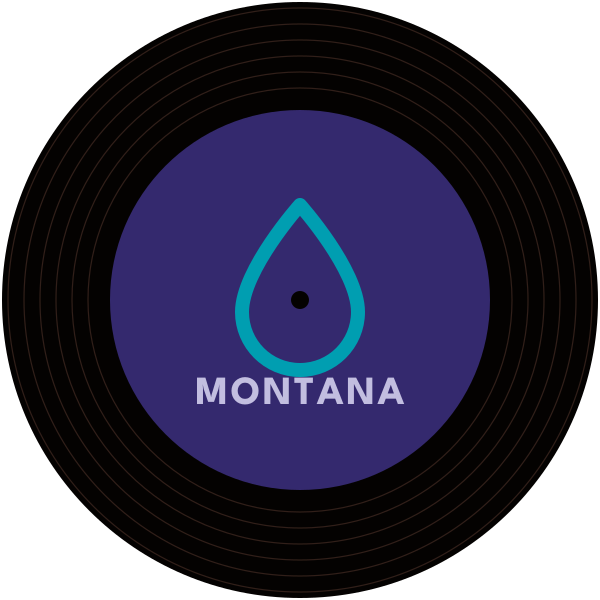
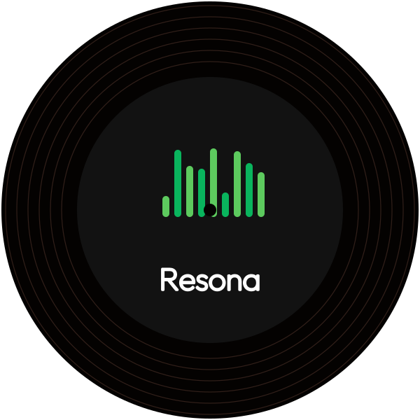
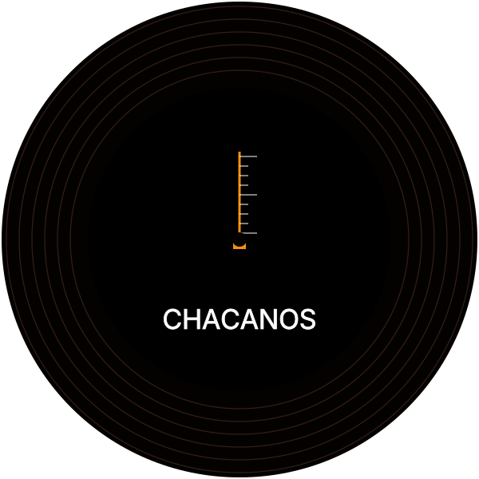

**[Portfolio · morvenlabs.dev](https://morvenlabs.dev)** &nbsp;·&nbsp; **[Blog · blog.morvenlabs.dev](https://blog.morvenlabs.dev)** &nbsp;·&nbsp; **[LinkedIn](https://www.linkedin.com/in/morvenlabs)** &nbsp;·&nbsp; **[Instagram](https://www.instagram.com/morvenlabs.dev/)** &nbsp;·&nbsp; **[hola@morvenlabs.dev](mailto:hola@morvenlabs.dev)**

I'm José Manuel Morales, known as Morven: an AI software engineer at Jalasoft in Cochabamba, Bolivia. I work with .NET and React, mostly moving legacy systems to a modern stack while they keep running in production, and I build with Claude Code every day.

On my own I design, ship and self-host web products end to end, from the interface to the API, the database and the deploy pipeline. I studied Commercial Software Engineering at Salesiana University of Bolivia on a Jala Foundation scholarship, and I was an ICPC South America finalist in 2023.

Every project below is live, built solo, and shown honestly: what is in production, what is a demo, and what is still on the way. Each one has its own case study on my portfolio.

<table>
  <tr>
    <td width="33%" align="center" valign="top">
      
      <h3>Montana</h3>
      
Operations platform for an ice, water and juice producer: orders, trips, fleet and chat, with a workspace per role. My degree project.

      
Next.js · .NET · PostgreSQL · Redis · RabbitMQ · SignalR

      
<a href="https://montanabolivia.app"><b>Live site</b></a> · <a href="https://morvenlabs.dev/en/projects/montana/">Case study</a>

    </td>
    <td width="33%" align="center" valign="top">
      
      <h3>Resona</h3>
      
Music streaming demo with role-based auth, an admin panel and a global player. The catalog is fictional.

      
Next.js · TypeScript · Firebase · shadcn/ui

      
<a href="https://resona.morvenlabs.dev"><b>Live demo</b></a> · <a href="https://morvenlabs.dev/en/projects/resona/">Case study</a>

    </td>
    <td width="33%" align="center" valign="top">
      
      <h3>Chacanos</h3>
      
Catalog and admin panel for the exclusive Petzl distributor in Bolivia, rebuilt from WordPress. 357 products.

      
Next.js · Hono · Prisma · PostgreSQL · Redis · Clerk

      
<a href="https://chacanos.shop"><b>Live site</b></a> · <a href="https://morvenlabs.dev/en/projects/chacanos/">Case study</a>

    </td>
  </tr>
</table>

The foundations I reuse on my own projects, public and ready to fork.

| Repository | What it is |
| --- | --- |
| [**static-site-template**](https://github.com/morvenlabs/static-site-template) | Minimal Astro 7 starter for portfolios and blogs: Tailwind v4, an nginx image and CI/CD to Dokploy. |
| [**web-project-template**](https://github.com/morvenlabs/web-project-template) | Production-ready monorepo: Hono, Prisma and Postgres API, Next.js with shadcn/ui and Clerk, Docker and GitHub Actions. |
| [**Yusi**](https://github.com/morvenlabs/Yusi) | A programming language interpreted in C#, made for speakers of Quechua. |
| [**c-sharp-calculator**](https://github.com/morvenlabs/c-sharp-calculator) | A calculator built with SOLID, TDD, the Composite pattern and an MST to order operations. |

**Languages and frameworks** &nbsp; C# · .NET · ASP.NET Core · TypeScript · JavaScript · React · Next.js · Redux · Hono · Astro · Tailwind CSS
**Data and infra** &nbsp; PostgreSQL · SQL Server · Entity Framework Core · Prisma · Redis · RabbitMQ · Docker · Azure · Dokploy · GitHub Actions · Jenkins · Git
**AI-assisted development** &nbsp; Claude Code, with Anthropic certificates

Have a product to build or a system to fix? Write to **[hola@morvenlabs.dev](mailto:hola@morvenlabs.dev)**, or read how I work on the **[blog](https://blog.morvenlabs.dev)**.
